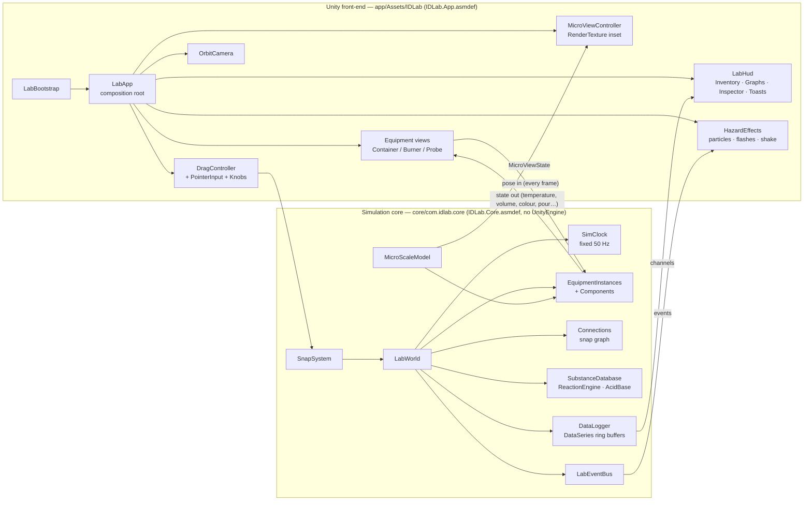
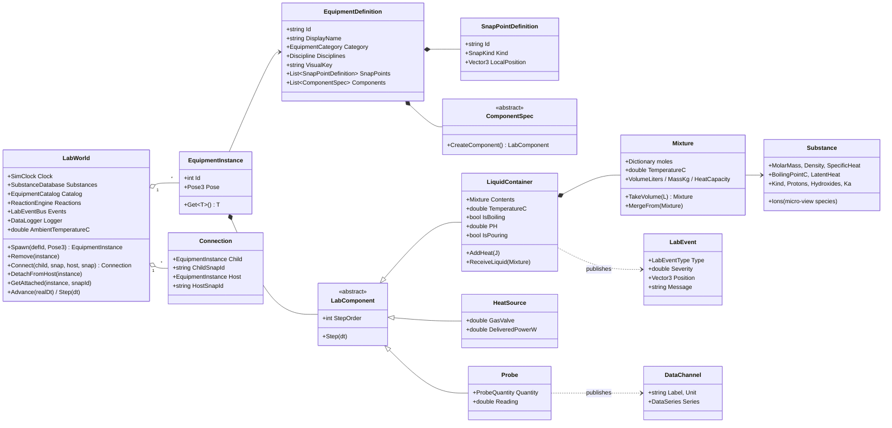
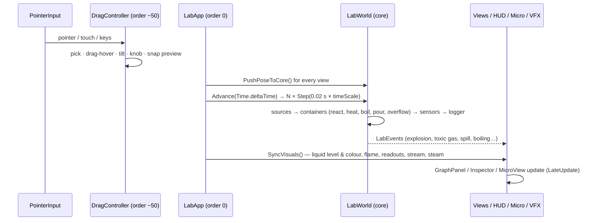

# ID Lab — Architecture

ID Lab is a native 3D science laboratory for desktop (Windows / macOS / Linux) and mobile (iOS / Android)
that unifies high-school Physics, Chemistry and Biology experiments in one app — a 3D, next-generation take
on PhET-style simulations.

This document covers the engine choice, the layer split, the data model, the per-frame simulation loop,
how each experiment module plugs in, and the roadmap from this prototype to the full product.

---

## 1. Engine choice: Unity 6 (C#)

| Requirement | Why Unity fits |
| --- | --- |
| One codebase for Windows, macOS, Linux, iOS, Android (and ChromeOS / tablets) | First-class build targets; IL2CPP for mobile performance |
| Rigid-body physics for drag, drop, stacking, knocking things over | Built-in PhysX (`Rigidbody`, colliders, raycasts) |
| Particle effects (smoke, steam, sparks, explosions, chlorine gas) | Shuriken particle systems now, VFX Graph later |
| Transparent glass, liquids, emissive flames, PBR lab materials | Built-in RP for the prototype, URP for shipping (the material factory supports both) |
| Second camera rendering an atomic-scale inset | Camera → `RenderTexture` → UI `RawImage` |
| Touch + mouse + keyboard | Input System package, with the legacy Input Manager as a fallback (both supported) |
| Education market: accessibility, localisation, offline use | Mature packages (Localization, Addressables) and fully offline builds |

**The key architectural decision:** the scientific simulation does **not** live in Unity. It is a pure C#
library (`com.idlab.core`, `netstandard2.1`, C# 9, `noEngineReferences: true`). That gives us:

* **Correctness you can test** — 35 xUnit tests run with plain `dotnet test`, in CI, in about a second, with no Unity licence.
* **Determinism** — a fixed 50 Hz timestep that does not depend on the device's frame rate, so a phone and a desktop produce the same graph.
* **Portability** — the same core could drive a server-side grader, a headless content validator (`tools/sim-cli`), or another engine front-end later.

---

## 2. Layers



### Who owns what

| Concern | Owner | Notes |
| --- | --- | --- |
| Where things are; collisions; falling; stacking | **Unity** (PhysX) | Transforms are mirrored into the core as `Pose3` each frame |
| What is attached to what (beaker on burner, probe in beaker, wire on terminal) | **Core** (`Connection`s) | The view hierarchy (parenting) follows core connection events |
| Heat, temperature, boiling, evaporation | **Core** (`LiquidContainer`, `HeatSource`) | Lumped thermal model |
| Chemistry: mixing, reactions, pH, indicator colour | **Core** (`Mixture`, `ReactionEngine`, `AcidBase`) | Rule based |
| Pouring (when it starts, how fast it flows, where the stream lands) | **Core** (`PourModel`, `LiquidContainer`) | Uses the pose's tilt, so Unity just rotates the bottle |
| Sensors and logging | **Core** (`Probe`, `DataLogger`) | Fixed-rate sampling in simulated time |
| Hazards (explosion, toxic gas, spill, short circuit) | **Core** decides, **Unity** renders | Through `LabEvent`s |
| Atomic-scale picture | **Core** describes (`MicroViewState`), **Unity** animates | |

---

## 3. Repository layout

```
idlab/
├── core/                              Engine-agnostic simulation (pure C#)
│   ├── IDLab.Core.csproj              dotnet build of the package sources (netstandard2.1, C# 9, warnings = errors)
│   ├── com.idlab.core/                Unity package (UPM), consumed by app/ via a file: reference
│   │   ├── package.json
│   │   └── Runtime/
│   │       ├── IDLab.Core.asmdef      noEngineReferences: true
│   │       ├── Common/                Pose3, ColorRGBA, PhysicalConstants
│   │       ├── Simulation/            LabWorld, SimClock
│   │       ├── Model/                 Equipment / Experiment definitions & catalogs, Connection, ComponentSpecs, ReagentPreset
│   │       ├── Components/            LabComponent, LiquidContainer, HeatSource, Probe
│   │       ├── Chemistry/             Substance(Database), Mixture, ReactionEngine (+rules), AcidBase, IndicatorColors, PourModel
│   │       ├── Interaction/           SnapSystem, SnapRules
│   │       ├── Events/                LabEvent, LabEventBus
│   │       ├── Data/                  DataSeries (ring buffer), DataLogger, DataChannel
│   │       └── Micro/                 MicroScaleModel, MicroViewState
│   └── tests/IDLab.Core.Tests/        xUnit tests
├── app/                               Unity 6 project (open this folder in Unity Hub)
│   ├── Packages/manifest.json         includes "com.idlab.core": "file:../../core/com.idlab.core"
│   ├── ProjectSettings/ProjectVersion.txt
│   └── Assets/IDLab/
│       ├── Scripts/                   IDLab.App.asmdef
│       │   ├── App/                   LabBootstrap, LabApp, LabEnvironment
│       │   ├── Views/                 EquipmentView (base), ContainerView, BurnerView, ProbeView, EquipmentViewFactory
│       │   ├── Interaction/           PointerInput, DragController, KnobInteractable, OrbitCameraController
│       │   ├── UI/                    LabHud, GraphPanel, LineGraph, InspectorPanel, InventoryItem, ToastPresenter, UIFactory, UITheme
│       │   ├── Micro/                 MicroViewController
│       │   ├── Vfx/                   HazardEffects, ParticleBuilder
│       │   ├── Rendering/             MaterialFactory (Built-in + URP), MeshFactory (lathe meshes, level liquid surface)
│       │   └── Util/                  CoreConversions
│       └── Editor/                    IDLabBuildSetup (keeps runtime shader variants in player builds)
├── tools/
│   ├── unity-typecheck/               Compiles all Unity scripts against Unity reference assemblies (CI, no Unity install)
│   └── sim-cli/                       Headless scenario runner (heating curve, neutralisation)
└── docs/ARCHITECTURE.md
```

The prototype is **built entirely in code**, so there are no binary scenes, prefabs or materials to merge.
Press Play in any scene and `LabBootstrap` builds the whole lab. Authored art (prefabs looked up by
`VisualKey`, via Addressables) replaces the procedural builders in production without touching the core.

---

## 4. Data model



### Definitions vs. instances

* **`EquipmentDefinition`** is *data only*: id, name, category, disciplines, `VisualKey`, snap points and a
  list of `ComponentSpec`s. Definitions sit in an `EquipmentCatalog`. The built-in catalog is code today and
  can load from JSON / ScriptableObjects later, because specs are plain property bags.
* **`EquipmentInstance`** is a live object on the bench: unique id, `Pose3`, and the `LabComponent`s created
  from the specs. Behaviour is **composed**: a beaker is a `LiquidContainer`, a burner is a `HeatSource`, a
  thermometer is a `Probe`. A future "hot plate with stirrer" is `HeatSource` + `Stirrer` with no new class
  hierarchy.
* **`ExperimentDefinition`** lists the equipment the inventory offers, the initial bench layout, objectives,
  discipline and status (`Playable` / `Planned`). All modules from the brief are registered, so menus,
  progress tracking and content pipelines can be built now.

### Snap graph

Snap points are typed (`SnapKind`): `ContainerBase`, `HeatSurface`, `ProbeTip`, `ProbePort`, `Terminal`,
`WireEnd`, `RailMount`, `StageSlot`. `SnapRules.AreCompatible` says which kinds fit together. A
`Connection` (child → host) is the source of truth for "what is attached to what". Physics drives *where*
things are; connections drive *what is interacting*. Examples: the burner heats whatever is on its
`heat_surface`, a probe reads whatever its `tip` sits in, and a circuit solver will read the graph of
`WireEnd` ↔ `Terminal` connections.

`SnapSystem.TryFindDropSnap` is the drag-time query: it matches on horizontal distance, allowing the dragged
item to be up to 40 cm *above* the target (items hover over whatever is under them while dragged).

### Chemistry

* `Substance`: molar mass, density, specific heat, boiling point, latent heat, acid/base strength (`Protons`,
  `Hydroxides`, `Ka`, conjugate base), the ions it shows in the micro view, and its colour.
* `Mixture`: moles per substance plus one bulk temperature. Volumes are ideal sums. `TakeVolume` splits
  proportionally (pouring). `MergeFrom` mixes temperatures by heat capacity.
* `ReactionEngine` runs `IReactionRule`s until nothing changes. The built-in rules are neutralisation
  (HCl/NaOH, CH₃COOH/NaOH, with ΔH released as heat), Na + H₂O (fizz, or an explosion above about 0.5 g)
  and bleach + acid (Cl₂ toxic gas). Reactions are treated as instantaneous relative to the 20 ms tick.
* `AcidBase.ComputePH` handles excess strong acid or base (with water autoionisation), weak acids (exact
  quadratic), buffers (Henderson–Hasselbalch) and conjugate-base hydrolysis. That is enough for a full
  titration curve.

### Thermal model (per container, per tick)

```
C      = m_glass·c_glass + Σ mᵢ·cᵢ                       (J/K)
P_loss = h·A·(T − T_ambient),  h ≈ 10 W/m²K               (convection)
T'     = T + (Q_in − P_loss·dt) / C                       (Q_in from burner/reactions this tick)
if T' > T_boil of the most volatile component:
    excess energy → evaporates m = E / L_v, T clamps at T_boil   ← the heating-curve plateau
```

The CLI run of the default setup shows 150 mL of water reaching 100 °C at about 110 s with about 525 W
delivered (analytic: 108 s), then holding at 100 °C while evaporating about 14 mL/min.

### Pouring

For an open cylinder of height H and diameter D, filled to height h and tilted by θ, the liquid reaches the
lip once `h + (D/2)·tanθ ≥ H`. Past that point the outflow follows a sharp-crested weir law,
`Q = Cd·(2/3)·w·√(2g)·head^1.5`. The stream falls from the lowest rim point. The first open container whose
mouth is under that point receives the liquid (temperatures equilibrate). If there is none, the liquid
spills and a `Spill` event fires. Fuller vessels start pouring at a smaller tilt.

### Sensors & data

`Probe` components (thermometer, pH probe) have first-order response lag (`τ`) and register a
`DataChannel` with the `DataLogger` when spawned. The logger samples every 0.25 s of **simulated** time into
allocation-free `DataSeries` ring buffers (4096 samples, about 17 minutes). The graph panel subscribes to
channel add/remove, so every sensor dropped on the bench gets its own live chart automatically. Plots of one
quantity against another (V–I, pH–volume) are the same buffers with a different x channel (roadmap).

### Micro view

`MicroScaleModel.Describe(container)` returns a `MicroViewState`:

* the mode (`ThermalMotion`, `IonDissociation`, later `ElectronFlow`);
* the phase (liquid or boiling);
* the speed factor `√(T/293 K)`;
* a particle census.

The census is allocated by **formula unit**, so Na⁺ and Cl⁻ counts always match. Weak acids show their
actual degree of dissociation, and solutes are visually exaggerated (about 45 % of particles) and labelled
as not to scale. The Unity side only animates this: Brownian motion, wall bounces, and molecules escaping
during boiling.

---

## 5. Frame loop



* **Simulation speed**: `Pause / 1× / 5× / 20×` change `SimClock.TimeScale`. Fixed steps keep results identical at every speed. Steps per frame are capped (60) so slow devices fall behind instead of freezing.
* **Step order** inside a tick is explicit (`LabComponent.StepOrder`: sources 0 → containers 100 → sensors 200), so heat added by a burner in a tick is absorbed in that same tick.

---

## 6. Interaction design

| Action | Desktop | Mobile / tablet |
| --- | --- | --- |
| Add equipment | Drag sideways out of the inventory, or click it | Drag out, or tap (places it mid-bench) |
| Move | Left-drag the item (it hovers above whatever is under it) | One-finger drag |
| Attach | Release over a glowing snap ring (gauze, probe port) | Same |
| Remove | Drop back onto the inventory, `Delete`, or Inspector → Remove | Drop onto inventory / Inspector |
| Pour | Hold `Q` / `E` while holding or after selecting a container; tilted items stay "in hand" | Inspector **Pour** slider |
| Turn a knob (gas valve) | Drag the red 3D knob | Drag the knob / Inspector slider |
| Orbit / zoom | Right-drag (or drag empty space) / wheel | Drag empty space or two-finger drag / pinch |

The UI is built in code with uGUI and a dark theme (`UITheme`). It scales with screen size, and the side
panels can be toggled from the top bar for phones.

---

## 7. Adding content

**New equipment** (for example a 100 mL graduated cylinder):
1. Add an `EquipmentDefinition` to `EquipmentCatalog` with snap points and a `LiquidContainerSpec`.
2. Reuse an existing `VisualKey` (`"beaker"`) or add a view class and register it in `EquipmentViewFactory`.
   Unknown keys get a grey placeholder box, so content can be tested before the art exists.

**New reaction**: implement `IReactionRule` (or reuse `NeutralizationRule`), then register it in
`ReactionEngine.CreateDefault`. Effects you return become VFX and toasts automatically.

**New experiment**: add an `ExperimentDefinition` (equipment list, initial layout, objectives) to
`ExperimentCatalog`. It appears in the top-bar selector when `Status = Playable`.

**New physics or biology module**: add `LabComponent`s, snap kinds and rules in the core, plus views in
Unity (see the roadmap).

---

## 8. Module roadmap

| Module | Core work | Unity work |
| --- | --- | --- |
| ✅ Heating curve | `HeatSource`, thermal model, boiling | Burner + flame, beaker, steam, thermometer |
| ✅ Acids, bases, pH | `Mixture`, `AcidBase`, neutralisation | Bottles, pour stream, indicator colours, pH probe |
| ✅ Improper mixing (safety) | Hazard rules, `LabEvent` | Explosion / gas / fizz VFX, camera shake, toasts |
| Titration | Burette component with stopcock flow; V-vs-pH plot | Burette view, stopcock knob, drop particles |
| DC circuits | `CircuitSolver` (modified nodal analysis over the `WireEnd`/`Terminal` graph), `Battery`, `Resistor`, `Bulb`, `Fuse` (I²t melt), `Switch`; short circuit = source current ≫ rating → `Spark`/`Smoke` events, `FuseBlown` opens the branch | Spline wires snapping to terminals, glowing bulbs, multimeter, sparks/smoke; micro view `ElectronFlow` (drift speed ∝ I/(nAq)) |
| AC circuits | Time-domain solver step with C/L companion models | Function generator, oscilloscope trace |
| Optics bench | Ray tracer (Snell's law, thin-lens equation, total internal reflection) | Laser beam line renderers, lenses/prisms on `RailMount` |
| Springs & pendulums | Semi-implicit integrators; energy channels | Spring mesh deformation, period stopwatch |
| Microscope | Focus/magnification state, depth of field function | Eyepiece view via render texture with blur by focus error, ×4/×10/×40 turret, slide on `StageSlot` |
| Photosynthesis | O₂ rate = f(light, CO₂, temperature) | Elodea, lamp distance, bubble particles, gas syringe |

Platform roadmap: switch to URP (the material factory already supports it) with per-platform quality tiers.
Add Addressables for art, the Localization package, accessibility (high contrast, screen-reader labels via
UI Toolkit), and save/load of a bench (`LabWorld` → JSON). Add a teacher mode (locked inventories, guided
steps) and lab reports exported from `DataSeries` as CSV.

---

## 9. Quality & performance budgets

* **Tests**: core logic is covered by `core/tests` (chemistry, thermal, pouring, snapping, logging, micro census, clock). CI also type-checks every Unity script against Unity reference assemblies (`tools/unity-typecheck`). That catches API errors without a Unity licence, but it does not replace Play-mode tests in Unity.
* **Mobile budget**: 60 fps target on mid-range devices. The simulation is O(components) at 50 Hz. Graphs reuse ring buffers and decimate to about one vertex per pixel. The micro view caps at 60 particles in a 640×480 render texture. Particle systems destroy themselves after one-shot effects.
* **Known simplifications** (prototype): ideal mixing volumes; one bulk temperature per container; reactions are instantaneous; the liquid surface uses a cylinder approximation for every vessel shape; free equipment is kept upright (rotation is frozen) except during deliberate tilting.
